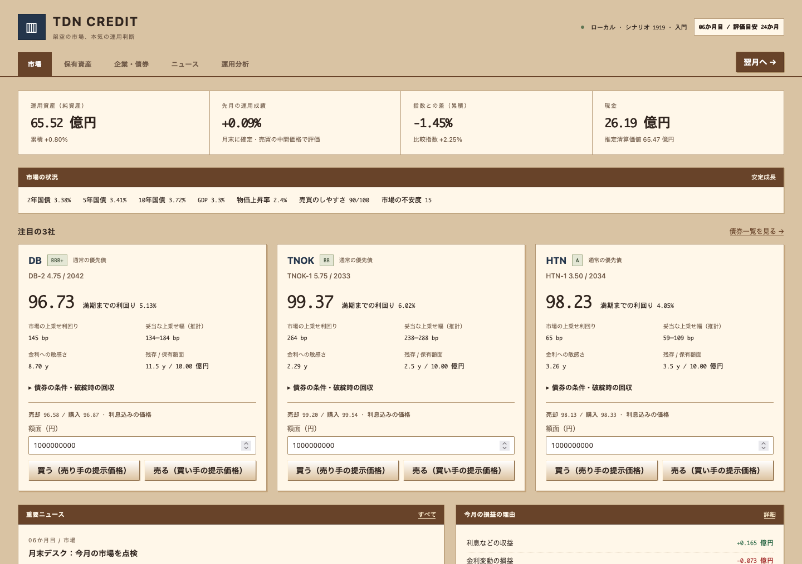

# TDN CREDIT

債券を売り買いして、架空のファンドを運用するゲームです。

手元の65億円をどこに投資するか、あるいは現金で残すか。企業の決算やニュース、金利の動きを見ながら判断し、運用成績を市場平均と比べます。
利回りが高くても、価格が下がれば損をすることがあります。安定した会社の債券でも、買う値段によって結果は変わります。

「なぜ利益が出たのか」「何を見落としたのか」は、あとから損益の内訳で振り返れます。債券に詳しくなくても、少しずつ試しながら遊べます。

**[ダウンロード](https://github.com/relemon8/tdn-credit/releases)** · [更新履歴](CHANGELOG.md)



## はじめるには

ダウンロードページから、自分のOSとCPUに合うファイルを選んで展開してください。
各ファイルにREADMEと「はじめに.txt」を同梱しています。

| 環境 | ファイル名の目印 |
|---|---|
| LinuxのIntel・AMD PC | `x86_64-unknown-linux-musl` |
| LinuxのARM64機 | `aarch64-unknown-linux-musl` |
| OpenBSD 7.9のARM64機 | `aarch64-unknown-openbsd-7.9` |
| Apple Silicon搭載Mac | `aarch64-apple-darwin` |
| Intel Mac | `x86_64-apple-darwin`（試験版） |
| WindowsのIntel・AMD PC | `x86_64-pc-windows-gnu`（試験版） |

Intel Mac版とWindows版はビルドのみ確認しており、実機での動作は未確認です。Androidアプリはまだ配布していません。
環境ごとの詳しい確認状況は、[配布・検証の記録](docs/release-0.1.1.md)にまとめています。

Linux・OpenBSDでは、展開したフォルダで次を実行します。

```sh
./start.sh
```

Macでは `TDN-CREDIT.command`、Windowsの試験版では `start.bat` から起動できます。
ブラウザが開いたらそのまま遊べます。自動で開かないときは、**http://127.0.0.1:3000** を開いてください。
終了するときは、起動したターミナルで `Ctrl+C` を押します。

ダウンロード後はオフラインで遊べます。アカウント登録、APIキー、追加の開発ツールは必要ありません。
Mac版は署名・公証をしていないため、起動時にOSの確認が表示される場合があります。

## 遊び方

気になる企業のニュースと数字を見て、債券を買ったり売ったりします。買わずに現金で待つこともできます。
判断が済んだら「翌月へ」。月が進むと市場や企業の状況が変わり、保有している債券の価格や運用成績に反映されます。

「保有資産」で今の持ち物を、「運用分析」で損益の理由を確認できます。
最初は画面下部の「遊び方」を開いてみてください。短い説明と、数字の読み方まで含めた詳しい説明を用意しています。

企業は10社、最初の債券は20銘柄です。24か月目に成績を確認できますが、そこで終了せず、そのまま運用を続けられます。
満期を迎えた債券は償還され、新しい借り換え債も登場します。

## セーブと更新

操作が成功すると自動で保存します。手動での保存と読み込みは、画面下部の「セーブ・設定・新しいゲーム」から行えます。

同梱の起動スクリプトを使うと、セーブは同じフォルダの `data` に保存されます。
更新するときはゲームを終了し、古いフォルダの `data` を新しいフォルダへコピーしてください。
実行ファイルを直接、引数なしで起動する場合はOSの標準保存先を使います。
[保存先や起動オプションの詳細](docs/technical-guide.md#save--load)も参照できます。

## このゲームについて

ゲーム内の企業・証券・市場、資金や損益はすべて架空です。実際のお金は使用せず、換金もできません。
実在の企業や証券とは関係がなく、投資助言を目的とするものでもありません。金融モデルはゲーム向けに簡略化しています。

完全無料で、広告や課金はありません。ソースコードは[MITライセンス](LICENSE)で公開しています。
**開発にはOpenAI Codexを使用しています。** ゲームの動作にCodexやLLMのAPIは使いません。
セーブはローカルに保存し、利用状況の収集や外部へのデータ送信は行いません。

企業名や一部のテロップ・実績名には、淫夢系のネットミームを使っています。語録の演出は設定でOFFにできます。
元映像や実在人物の画像・音声は同梱していません。

## ソースからビルドする

Rust 1.89以上とCコンパイラが必要です。初回は依存ライブラリを取得するため、ネット接続が必要になります。

```sh
cargo build --release --locked
./target/release/tdn-credit --portable
```

開発はLinuxを中心に進めています。対応の優先順位はLinux、OpenBSD、macOS、Android、Windowsです。

開発やモデルに興味がある方は、[技術ガイド](docs/technical-guide.md)、[金融モデル](docs/financial-model.md)、[検証記録](docs/verification.md)をご覧ください。
依存ライブラリのライセンスは[THIRD_PARTY_NOTICES.md](THIRD_PARTY_NOTICES.md)に記載しています。
